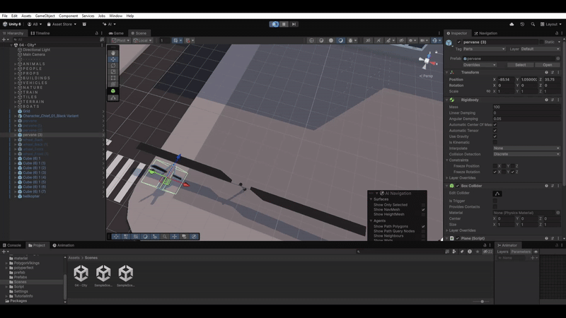

# 🚗 Modular Vehicle Builder

**Build your own vehicles by snapping parts together!**  
A Unity prototype where you can grab, connect, and drive modular blocks (wheels, bodies, engines, propellers) to create wild vehicles.

---

---
## ✨ Highlights
- 🧩 **Snap-to-fit building** – Parts connect via precise attach points.
- ⚖️ **Dynamic physics** – Mass & center of mass update as you build.
- 🏎️ **Driving system** – WheelColliders for steering, acceleration, braking.
- 🚁 **Special modules** – Helicopter propeller for lift-off (toggleable).
- 🛠️ **Sandbox flow** – Build → test → iterate; crash to stress-test joints.

---

## 🎮 Gameplay Preview

- Building with cubes + wheels  
- Test drive on terrain  
- Helicopter module demo (lift + thrust)

---

## 🕹️ Controls
- **W / S** – Accelerate / Reverse  
- **A / D** – Steer Left / Right  
- **Space** – Brake  
- **G** – Toggle Propeller (if attached)  
- **Mouse** – Grab & Place Parts

---

## 📂 Project Overview
- `AttachPoint` – Snap & FixedJoint creation between parts  
- `Cube` – Tracks connected rigidbodies for the assembled vehicle  
- `DynamicCenterOfMass` – Recalculates COM at runtime  
- `FrontWheel` / `RearWheel` – WheelCollider + mesh sync  
- `CarController` – Applies input, torque, steer, and brake  
- `GridCreator` – 3D grid placement and occupancy  
- `ObjectGrabber` – Pick up / drop with mouse raycasts  
- `HelicopterPropeller` – Optional lift/thrust module

---

## 🛑 Known Limitations
- Prototype codebase (no UI yet).  
- Simplified detach/break rules.  
- Game loop focused on “build & drive” sandbox.

---

## 🚀 Roadmap
- Stronger **detach system** (auto-cleanup on joint break).  
- **Save/Load** vehicles.  
- Editor tools for part/attach-point authoring.  
- More modules: engines, fuel, exhaust, weapons.

---

## ⚙️ Tech Stack
- Unity 2022.x  
- C#  
- Physics: WheelColliders, Rigidbodies, FixedJoints

